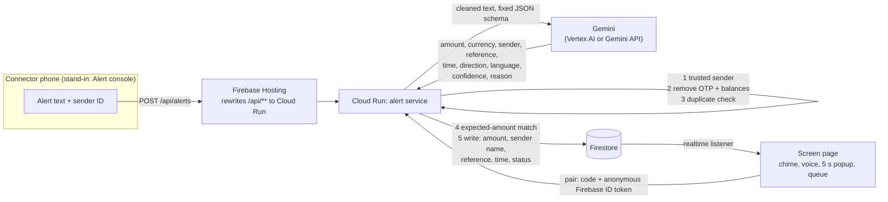

# Jugnu Alert

> Hear "payment received" seconds after the bank's alert, without calling the account owner.

**Jugnu Alert** is a shop counter screen that chimes, speaks and pops up a very large amount the moment a bank payment alert arrives. **Gemini** reads the alert, whatever the bank, layout or language. *Jugnu* means firefly in Urdu and Hindi: a small light that appears the moment something arrives.

This repository is the **live web prototype** for the **Google Cloud AI Builder Cup 2026** by **Team Jugnu**. It runs on **Gemini, Cloud Run, Firestore and Firebase Hosting**.

> **Synthetic data only.** Every sample alert, bank name (SampleBank, DemoBank, TestPay), person name, account number and amount in this repo is invented. Jugnu Alert has no bank access and cannot move money. It only reports that an alert arrived.

## The problem

Many shops show a QR code or account number that belongs to an owner or a third party. The alert that proves money arrived goes to *that* person's phone, not to the counter. Staff screenshot the customer's phone, call the owner and wait, while the queue stalls.

## What is in this prototype

| Piece | What it does |
| --- | --- |
| **Screen page** (`/`) | Landscape white screen: small centred QR code from the shop details, shop name, account number, link-status dot (green *Live*, amber *Reconnecting*, red *Offline*, always with text), chime, spoken line, 5-second popup with the amount in very large type and the sender below, a queue for several payments, and a pairing code to join a shop. |
| **Alert console** (`/console`) | Stands in for the Android Connector phone. Pick a synthetic sample or paste an alert, optionally set an expected amount, and send it to the same `POST /api/alerts` a real Connector would call. One click sends a **fake alert from an untrusted sender**, which is rejected. |
| **Alert service** (Cloud Run, Node.js + TypeScript) | Rules first, then Gemini, then a write to Firestore. See the pipeline below. |
| **Relay** (Firestore) | The Screen listens to events in realtime. Events are written only by the server and read only by a paired screen. |

Out of scope, as in the design: the Android Connector app, real SMS reading, the Play Store build, an admin console, production bank parsers, accounts beyond the pairing code, and any payment or money movement.

## Architecture



**Google Cloud services used:** Gemini (through Vertex AI or the Gemini API), Cloud Run, Firestore, Firebase Hosting, Firebase Authentication (anonymous sign-in for the pairing), Cloud Build and Artifact Registry (for `gcloud run deploy --source`). Secret Manager is optional (for a Gemini API key).

### The pipeline, in this order

`POST /api/alerts` with `{ "shopId", "sender", "text", "expectedAmount"? }`

1. **Trusted sender**: the sender ID must be on this shop's list. Otherwise the text is ignored and the event is `rejected`.
2. **Remove OTP lines and balances**: security-code sentences and balance figures (English, Urdu, Hindi, Roman and native script) are stripped before anything else reads the text. A message that is only an OTP is rejected.
3. **Duplicate check**: reference + amount + time, as a hash, before spending a Gemini call. Same alert again inside the window (24 h) is `rejected` as a duplicate. If Gemini fails, the claim is released so the Connector can safely retry.
4. **Gemini structured extraction**: one prompt, one fixed JSON schema: `amount, currency, senderName, reference, time, direction (credit/debit), language, confidence, reason`. The alert is wrapped as untrusted data; the answer is validated and clamped.
5. **Expected-amount match**: if the cashier set an expected amount, only a matching payment is confirmed.
6. **Write the event**: see what is stored below.

### Status rules

| Status | When | On the Screen |
| --- | --- | --- |
| `verified` | Genuine credit, confidence at or above the threshold (0.7), amount literally present in the text, alert time fresh, and it matches the expected amount if one was set | Chime, voice "Payment received", large popup |
| `unverified` | Low Gemini confidence; amount mismatch; amount not found in the text; stale or future alert time | Softer two-note tone, amber popup "Unverified: check before releasing goods". **Never announced as confirmed** |
| `rejected` | Untrusted sender, OTP only, duplicate, promotion, scam, debit alert, unreadable | No sound, no popup. A short red notice only |

### What is stored (and what is not)

Only **amount, sender name, reference, time and a status** come from the alert. Three more fields are technical: `currency` (qualifies the amount), `reasonCode` (a fixed vocabulary such as `amount_mismatch`, never free text) and `createdAt` (orders the feed). **The raw alert text is never stored**, and OTPs and balances never reach Gemini. The duplicate check keeps only a hash. A unit test asserts that the store holds none of the alert text.

Firestore layout: `shops/{shopId}` · `shops/{shopId}/events/{id}` · `shops/{shopId}/seen/{hash}` · `shops/{shopId}/screens/{uid}` · `pairings/{CODE}`. `firestore.rules` lets a **paired screen read** events, and nobody write them; the Cloud Run service uses the Admin SDK.

### How a screen is paired

The Screen signs in to Firebase anonymously and sends its pairing code and ID token to `POST /api/pair`. The server checks the code, verifies the token and records that user as a paired screen. Only then do the Firestore rules let it read that shop's events. (A pairing code is a shared secret, not an account: logins are out of scope for the prototype.)

## Run it locally (no credentials)

Needs Node.js 20 or newer.

```bash
npm install
npm run dev
```

Open the two pages in two browser windows:

* Screen: <http://localhost:8080/> (tap **Join shop**, or use `?code=JUGNU-DEMO`)
* Console: <http://localhost:8080/console>

With no credentials the app starts in **mock mode**: an in-memory relay and a regex stand-in for Gemini. The console shows a **"Gemini: MOCK"** badge so nobody mistakes it for the real model. The demo shop is `Jugnu Demo Store`, pairing code **`JUGNU-DEMO`**.

Optional: `cp .env.example .env` to change settings.

```bash
npm test            # 75 unit tests: rules, sample alerts, HTTP API, Gemini client
npm run typecheck
npm run build && npm start
```

To try real Gemini locally, set `MOCK_GEMINI=false` plus either `GEMINI_API_KEY=...` or `GOOGLE_CLOUD_PROJECT=...` (Vertex AI; run `gcloud auth application-default login` first).

### Configuration

| Variable | Default | Meaning |
| --- | --- | --- |
| `STORE` | `memory` | `memory` for local runs, `firestore` for Cloud Run |
| `MOCK_GEMINI` | auto | `true` forces the mock. If unset, local dev with no credentials uses the mock; **production refuses to start without credentials** |
| `GEMINI_API_KEY` | | Gemini API key (wins over Vertex AI when both are set) |
| `GOOGLE_CLOUD_PROJECT` | | Project ID: Firestore, and Vertex AI when no API key is set |
| `GOOGLE_CLOUD_LOCATION` | `global` | Vertex AI location |
| `GEMINI_MODEL` | `gemini-3.5-flash-lite` | A fast, low-cost model is enough for short alerts. Check Google's models page for the current name |
| `GEMINI_TIMEOUT_MS` | `15000` | Per-request timeout |
| `SEED_DEMO_SHOP` | `true` for memory | Create the synthetic demo shop in Firestore if missing |
| `FIREBASE_WEB_CONFIG` | | Optional JSON of the Firebase web app config; otherwise Hosting's `/__/firebase/init.json` is used |
| `CONFIDENCE_THRESHOLD` | `0.7` | Below this, an alert is Unverified |
| `DUPLICATE_WINDOW_MINUTES` | `1440` | Duplicate window |
| `MAX_ALERT_AGE_MINUTES` | `120` | Older (or future) alert times are Unverified; `0` disables |
| `RATE_LIMIT_PER_MIN` | `60` | Per IP on `/api/alerts` and `/api/pair`; `0` disables |

## Deploy to Google Cloud and Firebase

Deployment runs from **your own Google accounts**; nothing here deploys for you. You need a Google Cloud project with billing or credits, and a Firebase project on that same project. Commands are for bash (Git Bash on Windows). In PowerShell, put each command on one line.

Install the CLIs once: [Google Cloud CLI](https://cloud.google.com/sdk/docs/install) and `npm install -g firebase-tools`, then `gcloud auth login` and `firebase login`.

```bash
# 0. Your settings
export PROJECT_ID="your-project-id"
export REGION="asia-south1"          # must match the region in firebase.json
gcloud config set project "$PROJECT_ID"

# 1. Turn on the APIs
gcloud services enable run.googleapis.com cloudbuild.googleapis.com artifactregistry.googleapis.com \
  firestore.googleapis.com aiplatform.googleapis.com firebase.googleapis.com identitytoolkit.googleapis.com

# 2. Firestore (Native mode)
gcloud firestore databases create --location="$REGION" --type=firestore-native

# 3. A service account for the Cloud Run service
gcloud iam service-accounts create jugnu-alert-run --display-name="Jugnu Alert service"
for ROLE in roles/datastore.user roles/aiplatform.user; do
  gcloud projects add-iam-policy-binding "$PROJECT_ID" \
    --member="serviceAccount:jugnu-alert-run@${PROJECT_ID}.iam.gserviceaccount.com" --role="$ROLE"
done

# 4. Deploy the alert service to Cloud Run (Gemini through Vertex AI, no key to manage)
gcloud run deploy jugnu-alert \
  --source . \
  --region "$REGION" \
  --allow-unauthenticated \
  --service-account "jugnu-alert-run@${PROJECT_ID}.iam.gserviceaccount.com" \
  --max-instances 3 \
  --set-env-vars "STORE=firestore,GOOGLE_CLOUD_PROJECT=${PROJECT_ID},GOOGLE_CLOUD_LOCATION=global,GEMINI_MODEL=gemini-3.5-flash-lite,SEED_DEMO_SHOP=true"
```

**Gemini access, option B: an API key instead of Vertex AI.** Create a key in Google AI Studio, then keep it in Secret Manager:

```bash
gcloud services enable secretmanager.googleapis.com
printf '%s' "PASTE_KEY_HERE" | gcloud secrets create jugnu-gemini-key --data-file=-
gcloud secrets add-iam-policy-binding jugnu-gemini-key \
  --member="serviceAccount:jugnu-alert-run@${PROJECT_ID}.iam.gserviceaccount.com" --role=roles/secretmanager.secretAccessor
gcloud run services update jugnu-alert --region "$REGION" --update-secrets GEMINI_API_KEY=jugnu-gemini-key:latest
```

**Dry run first:** add `MOCK_GEMINI=true` to `--set-env-vars` to prove the whole path (Cloud Run, Firestore, Hosting, the Screen) before Gemini access is sorted, then remove it with `gcloud run services update jugnu-alert --region "$REGION" --remove-env-vars MOCK_GEMINI`.

```bash
# 5. Firebase: make the GCP project a Firebase project, register a web app
firebase projects:addfirebase "$PROJECT_ID"        # skip if it already is one
firebase apps:create web "Jugnu Alert Screen" --project "$PROJECT_ID"

# 6. In the Firebase console: Build > Authentication > Get started > Sign-in method > Anonymous > Enable.
#    (This is the one step that is a click, not a command.)

# 7. Publish the Screen and Console pages, the /api rewrite and the Firestore rules
firebase deploy --only hosting,firestore --project "$PROJECT_ID"
```

Your live link is `https://<PROJECT_ID>.web.app`. Check it:

```bash
curl "https://${PROJECT_ID}.web.app/api/health"     # {"ok":true}
curl "https://${PROJECT_ID}.web.app/api/config"     # shows store "firestore" and the Gemini model
```

Then open `https://<PROJECT_ID>.web.app/` and `https://<PROJECT_ID>.web.app/console` **in a private window** (judges will not be signed in), join with `JUGNU-DEMO`, and run the demo script below.

If you pick another region, change `region` in `firebase.json` too. After code changes, re-run step 4 (and step 7 if `public/` or the rules changed).

**Fallback if Firebase gives trouble:** the Cloud Run URL (`https://jugnu-alert-<hash>-el.a.run.app`) serves the Screen and Console pages too. Redeploy step 4 as a single always-on instance with the in-memory relay (the Screen then listens over Server-Sent Events instead of Firestore; events are lost on restart). It is less robust than Firestore, so use it only if you must:

```bash
gcloud run deploy jugnu-alert --source . --region "$REGION" --allow-unauthenticated \
  --service-account "jugnu-alert-run@${PROJECT_ID}.iam.gserviceaccount.com" \
  --min-instances 1 --max-instances 1 --timeout 3600 \
  --set-env-vars "STORE=memory,GOOGLE_CLOUD_PROJECT=${PROJECT_ID},GOOGLE_CLOUD_LOCATION=global,GEMINI_MODEL=gemini-3.5-flash-lite"
```

### Troubleshooting

| Symptom | Fix |
| --- | --- |
| Console says `gemini_unavailable` (HTTP 502) | Wrong or retired model name, or no access. Set `GEMINI_MODEL` to a current Flash model from Google's models page and redeploy. The alert is *not* burned: sending it again works. |
| Screen: `auth/operation-not-allowed` | Anonymous sign-in is not enabled (step 6). |
| Screen: "Firebase web app config not found" | Run `firebase apps:create web ...` (step 5), or pass the config as `FIREBASE_WEB_CONFIG` (`firebase apps:sdkconfig web --project "$PROJECT_ID"`). |
| Screen: "no longer paired" | Firestore rules deployed but the pairing was not recorded: reload and join again. |
| `/api/...` returns 403 from Hosting | The Cloud Run service must allow unauthenticated access (`--allow-unauthenticated`). |
| No sound | Browsers need one tap first. Tap **Tap to turn on sound**. |
| No Urdu/Hindi voice | Speech depends on the device's installed voices. The chime plays and the line is spoken in English instead. |

## Demo script

Follows the storyline in the design document. About 3 minutes.

| # | Say / do | What the audience sees |
| --- | --- | --- |
| 1 | "The problem in one sentence: the counter cannot see the payment." | |
| 2 | Open the **Screen** in landscape on a phone or laptop, join `JUGNU-DEMO`, tap to turn on sound. | White screen, small QR code, shop name, account number, green **Live** dot |
| 3 | In the **Console**, keep *English SMS, credit from SampleBank* and press **Send alert**. | Chime, voice, popup with the amount in very large type and the sender below. The console shows each rule passing and what Gemini read. |
| 4 | Pick the **Urdu (اردو)** sample, then **Hindi (हिन्दी)**, then a Roman-script one, and send each. | Same result from different formats and languages. Open **What Gemini saw** to show OTP and balance already removed. |
| 5 | Press **Send FAKE alert (untrusted sender)**. | Rejected at the first rule, no sound, a red notice on the Screen |
| 6 | Press **Send the same alert again**. | Rejected as a duplicate: one announcement per payment |
| 7 | Set **Expected amount**: **Same as sample**, send (confirmed); then **Different from sample**, send. | Match is confirmed; mismatch shows amber **Unverified** and is never announced as confirmed |
| 8 | Optional: send *Pending credit* and *Old alert replayed*. | Low confidence and stale alerts show as Unverified |
| 9 | Show this README's architecture diagram and the Google Cloud services list. | Gemini, Cloud Run, Firestore, Firebase Hosting |

Tip for the recording: use **Settings** (bottom-left of the Screen) to test the sound, set the volume and choose the spoken language.

## Trust, fraud and privacy: what is built

| Threat | In this prototype |
| --- | --- |
| Fake SMS from an ordinary number | Per-shop trusted sender list; anything else is rejected before any other step |
| Spoofed sender ID | Gemini scores whether the text reads like a genuine credit alert; low scores are Unverified. Gemini sees the alert only as untrusted data inside a fixed schema. |
| Replayed or duplicate alert | Duplicate fingerprint on reference + amount + time; old alert times are Unverified |
| Wrong amount | Optional expected-amount mode |
| Amount misread or invented by the model | The extracted amount must literally appear in the cleaned text |
| Passwords, OTPs, balances | Stripped before Gemini; never stored |
| Abuse of the endpoint | Body-size limit, validation, per-IP rate limit |

**Not in this prototype** (design and roadmap): reversal/failure alerts cancelling an earlier announcement, per-bank message-pattern and reference-format checks, email sender-domain checks, PIN-protected history, an admin console, accounts and logins beyond the pairing code, a per-device key for the Connector, and a retention period for events (set a Firestore TTL policy on `createdAt` if you want one). The Android Connector and real SMS reading are out of scope.

## Project layout

```
src/            Cloud Run service (TypeScript)
  pipeline.ts   the rule order and the status decision
  text.ts       trusted sender, OTP/balance removal, duplicate fingerprint
  gemini.ts     Gemini client, prompt and fixed JSON schema
  mockGemini.ts offline stand-in used when MOCK_GEMINI=true
  store.ts, firestoreStore.ts   in-memory and Firestore relay
  server.ts     HTTP API: /api/alerts, /api/pair, /api/config, /api/stream (local), /api/health
public/         Screen (index.html), Alert console (console.html), samples/alerts.json
test/           unit and HTTP tests (vitest)
Dockerfile  firebase.json  firestore.rules  .env.example
```

## Documentation

The design behind this prototype (problem, solution, always-online design, trust and privacy, Android publishing, roadmap) is in [`docs/`](docs/README.md): the [design proposal](docs/design-proposal.md), the [architecture](docs/architecture.md) and the [pitch deck content](docs/pitch-deck.md).

## License

Apache License 2.0. See [LICENSE](LICENSE).
