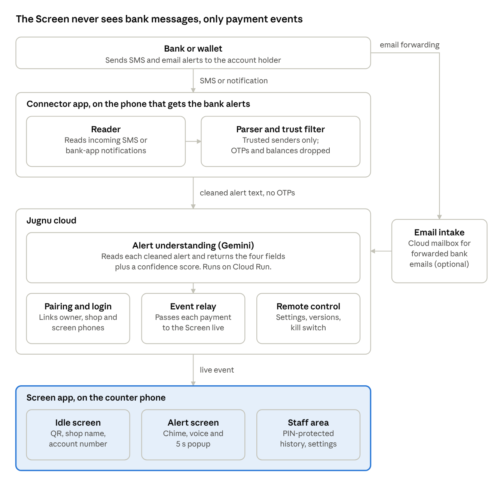
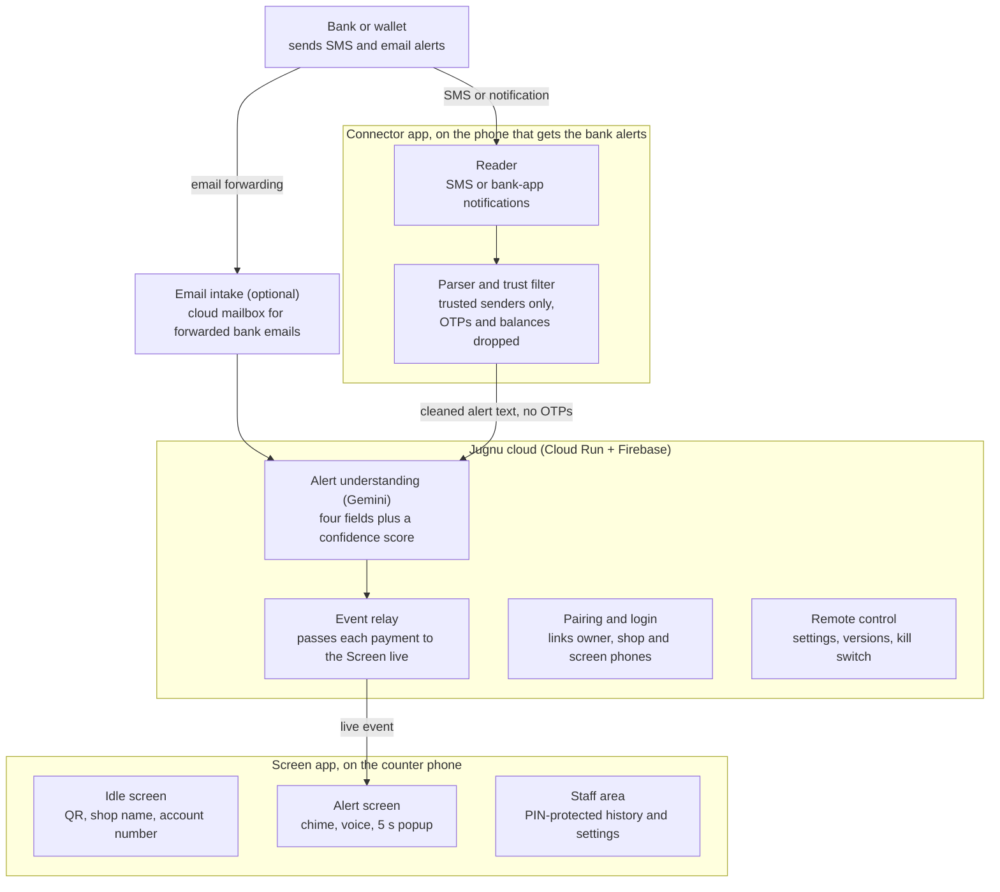
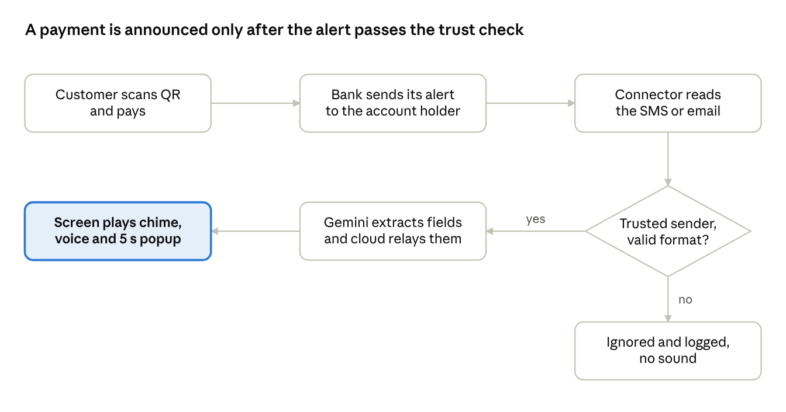
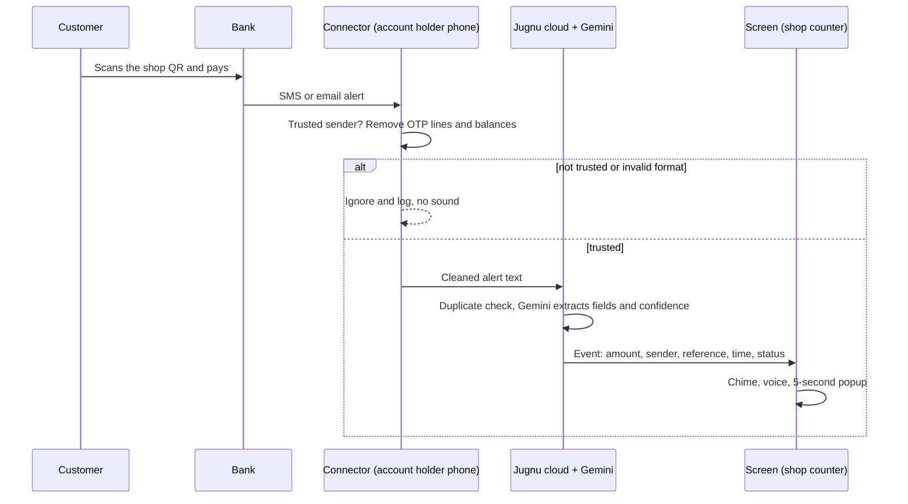
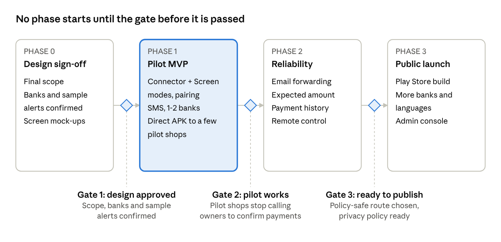
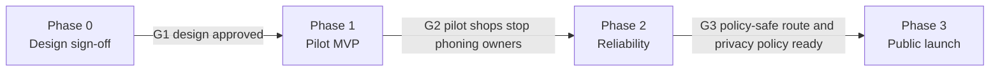

# Architecture

Jugnu Alert moves a bank's payment alert from the account holder's phone to the shop counter in seconds. This page holds the diagrams as images and as editable Mermaid source (GitHub renders the Mermaid blocks directly).

Design rule: **the Screen app never sees bank messages, only payment events.** Alerts are cleaned on the Connector phone, understood by Gemini in the cloud, and only four fields are stored.

## System architecture

## Payment flow

## Roadmap

## Data stored

Only these four fields are stored per payment, plus a status. The raw alert text is never stored.

| Field | Example (synthetic) | Notes |
|---|---|---|
| Amount | 2,500 | With currency |
| Sender name | Ali Khan | Falls back to the reference if missing |
| Reference | TXN-000123 | Used for duplicate detection |
| Time | 2026-10-17T10:15:00+05:00 | As shown in the alert |
| Status | verified, unverified or rejected | Low Gemini confidence is unverified, never announced as confirmed |
